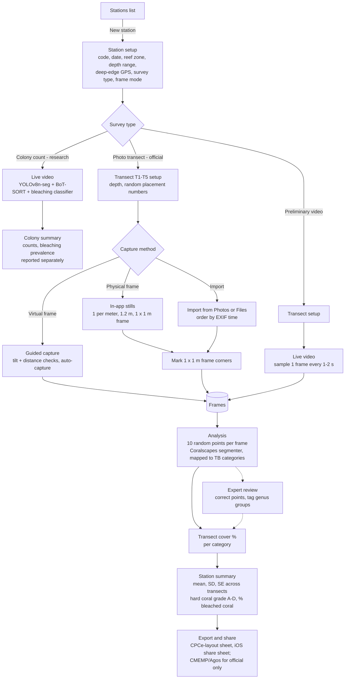
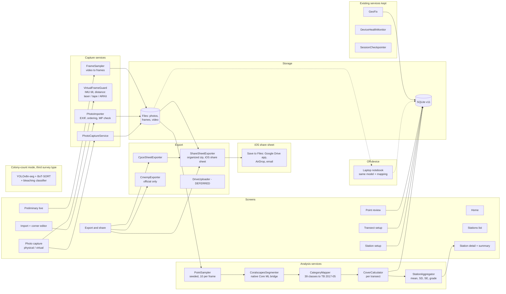
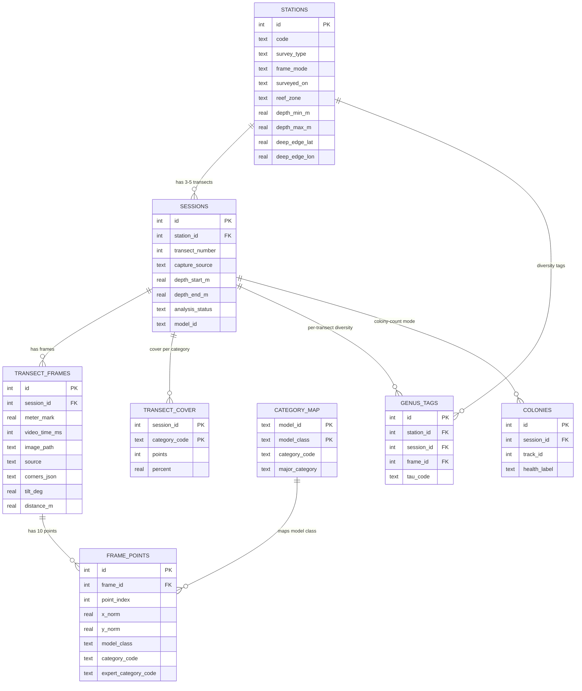

# ReefSight v2 blueprint

How the next version of ReefSight is organized, aligned to DENR-BMB Technical Bulletins 2019-04 and
2017-05: stations of 3–5 transects, three survey types, three ways to capture photo transects,
point-based cover analysis with the CoralscapesV2 segmenter, and station summaries in the CPCe layout.
Nothing here is built yet. The reasoning and decisions behind it are in
[denr-tb-2019-04-alignment.md](denr-tb-2019-04-alignment.md). Development is tracked in GitHub issues
#1–#19.

**Legend used below:** *new* · *changed* · *colony-count mode (kept as a third survey type)* ·
*deferred*.

## 1. Survey flow

From creating a station to the exported summary. A station has one survey type and one frame mode for
all its transects.



## 2. App architecture

Screens call services; services read and write the database and files.



**Architecture exception (decided November 13, 2026).** `mobile/CLAUDE.md` and the Specification
(Phase C, "Live inference") allow only the `ultralytics_yolo` plugin for on-phone models. The
Coralscapes SegFormer isn't a YOLO model, so it runs through a native Core ML bridge, as a deliberate
exception for the cover segmenter only; YOLO models stay on the plugin. Both documents get updated when
the bridge is built (#12), and only if the iPhone 14 speed test (#11) is acceptable. Until then,
analysis runs on a laptop with the same model and mapping (#7). `analyzed_on` records where each
transect was analyzed.

## 3. Database: entity relationships (schema v11)

One station has many transects (the existing `transect_sessions` table, called SESSIONS in the diagram). Each transect has many frames, each
frame has 10 points, and cover results are cached per transect and category. Old sessions keep
`station_id` empty and keep working.



## 4. Tables in detail

### `stations` (new)
A 75 × 25 m station (TB 2019-04). Survey type and frame mode are fixed here, so transects can't mix them.

| Column | Type | Meaning |
|---|---|---|
| id | INTEGER PK | Autoincrement |
| code | TEXT NOT NULL | Short ID, e.g. ALG-S1 |
| name | TEXT | Optional display name |
| survey_type | TEXT NOT NULL | `photo_transect` · `preliminary_video` · `colony_count` |
| frame_mode | TEXT | `physical` · `virtual` · `imported_mixed`; NULL for preliminary and colony count |
| surveyed_on | TEXT NOT NULL | ISO date |
| site_name | TEXT | Site or MPA (a sites table comes later) |
| reef_zone | TEXT | `reef_flat` · `reef_crest` · `upper_slope` · `lower_slope` |
| depth_min_m / depth_max_m | REAL | Flag if the max is over 6 m |
| deep_edge_lat / deep_edge_lon | REAL | Surface GPS fix of the deeper edge |
| deep_edge_accuracy_m | REAL | Fix accuracy |
| deep_edge_at | TEXT | ISO timestamp of the fix |
| deep_edge_source | TEXT | `gps` · `manual` (stored with `GeoFix.toColumns`, like the transect entry/exit fixes) |
| marker_placed | INTEGER | Concrete block placed (0/1) |
| observer_name | TEXT | Lead observer |
| notes | TEXT | Free text |
| created_at | TEXT NOT NULL | ISO timestamp |

### `transect_sessions` (changed)
The existing table: each session becomes one transect. All current columns stay; new columns are
nullable, so old surveys keep working.

| New column | Type | Meaning |
|---|---|---|
| station_id | INTEGER FK | `stations.id`; NULL for old surveys |
| transect_number | INTEGER | 1–5; unique within a station |
| capture_source | TEXT | `in_app_photos` · `imported_photos` · `in_app_video` · `legacy_colony` |
| depth_start_m / depth_end_m | REAL | Depth at each end of the tape |
| random_along_m | REAL | Random distance along the 75 m axis |
| random_swimout_m | REAL | Random swim-out, 0–25 m |
| points_per_frame | INTEGER | Default 10 (CPCe) |
| point_seed | INTEGER | Random seed, so point positions can be reproduced |
| analysis_status | TEXT | `pending` · `running` · `done` · `failed` |
| analyzed_at | TEXT | ISO timestamp |
| model_id | TEXT | e.g. `coralscapesv2-segformer-b5` |
| analyzed_on | TEXT | `phone` · `laptop` |

### `transect_frames` (new)
One row per scored image: a photo-transect still (one per meter) or a sampled video frame (preliminary).

| Column | Type | Meaning |
|---|---|---|
| id | INTEGER PK | Autoincrement |
| session_id | INTEGER FK NOT NULL | `transect_sessions.id` |
| meter_mark | REAL | 0–50 for photo transects; unique per session |
| video_time_ms | INTEGER | Preliminary frames |
| image_path | TEXT NOT NULL | Copy in app storage |
| source | TEXT NOT NULL | `in_app` · `imported` · `video_frame` |
| width_px / height_px | INTEGER | Flag if under 5 MP |
| camera_make / camera_model | TEXT | From EXIF |
| captured_at | TEXT | From EXIF, or the app's clock |
| corners_json | TEXT | The four corners of the 1 × 1 m area, normalized |
| corner_source | TEXT | `manual` · `copied` · `auto_detected` · `virtual` |
| tilt_deg | REAL | Phone tilt from vertical, if known |
| distance_m | REAL | Virtual mode |
| distance_method | TEXT | `laser` · `tape` · `arkit` |
| checks_passed | INTEGER | Virtual-mode checks passed (0/1) |
| fisheye_flag | INTEGER | Fisheye image suspected (0/1) |
| excluded / exclude_reason | INTEGER / TEXT | Dropped from scoring, with the reason |

### `frame_points` (new)
The 10 random points per frame, as in CPCe. Expert columns let a reviewer correct a point; corrections
are kept for validation and retraining.

| Column | Type | Meaning |
|---|---|---|
| id | INTEGER PK | Autoincrement |
| frame_id | INTEGER FK NOT NULL | `transect_frames.id` |
| point_index | INTEGER NOT NULL | 0–9; unique per frame |
| x_norm / y_norm | REAL NOT NULL | Position inside the 1 × 1 m area (0–1) |
| model_class | TEXT | Raw class, e.g. "branching bleached" |
| model_confidence | REAL | Class probability at the point |
| category_code | TEXT | TB code, e.g. CB, BLEC, DC, S, TWB |
| expert_category_code | TEXT | Reviewer's correction, if any |
| expert_name / reviewed_at | TEXT | Who reviewed it, and when |

### `category_map` (new)
Seeded lookup from model classes to TB 2017-05 categories, versioned by model, so a new model brings its
own mapping. The draft mapping for the 39-class CoralscapesV2 model is in
[denr-tb-2019-04-alignment.md §7](denr-tb-2019-04-alignment.md).

| Column | Type | Meaning |
|---|---|---|
| model_id | TEXT PK | e.g. `coralscapesv2-segformer-b5` |
| model_class | TEXT PK | e.g. "table acropora alive" |
| category_code | TEXT NOT NULL | e.g. ACT, CB, CM, BLEC, DC, S |
| major_category | TEXT NOT NULL | HC · DC · AA · OB · AB · TWB |
| excluded | INTEGER NOT NULL | 1 means not counted, like tape and shadow |

### `transect_cover` (new)
Cached % cover per transect and category, recomputed whenever points change. The station summary is
calculated from these rows, not stored.

| Column | Type | Meaning |
|---|---|---|
| session_id | INTEGER PK FK | `transect_sessions.id` |
| category_code | TEXT PK | A TB code or a major category |
| points | INTEGER NOT NULL | Points in this category |
| total_points | INTEGER NOT NULL | Points counted, after exclusions |
| percent | REAL NOT NULL | points ÷ total_points × 100 |
| uses_expert | INTEGER NOT NULL | 1 if computed with expert corrections |

### `genus_tags` (new, added with #10)
Expert tags of genus groups (TAUs). Diversity is reported both per transect (distinct TAUs in each
transect) and per station (distinct TAUs across all transects). The station figure gets the A–D grade.

| Column | Type | Meaning |
|---|---|---|
| id | INTEGER PK | Autoincrement |
| station_id | INTEGER FK NOT NULL | `stations.id` |
| session_id | INTEGER FK NOT NULL | `transect_sessions.id`, for the per-transect count |
| frame_id | INTEGER FK | Photo the tag is on |
| tau_code | TEXT NOT NULL | e.g. PORM, ACB, HEL (TB 2019-04 Table 3) |
| tagged_by / tagged_at | TEXT | Who tagged it, and when |

### `colonies` (unchanged)
Colony tracking records, used by the colony-count survey type. Its results are reported separately from
the bulletin cover summaries.

### `drive_uploads` (deferred)
Only needed for the in-app Google Drive upload, which is deferred. Sharing uses the iOS share sheet
(#9), which needs no table.

## 5. Migration v10 → v11

Follows the app's existing pattern: new tables plus nullable `ALTER TABLE … ADD COLUMN`, so existing
rows read back as NULL and old surveys open unchanged.

**Implemented in #1** (`lib/services/transect_database.dart`; walkthrough in
`sub-plans/20-schema-v11-stations.md`). Changes from the first draft of this section:
- **Table name.** The existing table is `transect_sessions`, not `sessions`.
- **Deep-edge columns.** The fix uses `GeoFix.toColumns('deep_edge')`, so the columns are
  `deep_edge_at` and `deep_edge_source` (`gps` · `manual`), not `deep_edge_fixed_at`.
- **Deleting a transect.** `deleteSession` removes its points, frames and cover first. Foreign keys
  are on and nothing cascades.
- **CHECK lists can't be changed later.** SQLite can't edit a CHECK in place, so a new survey type
  or frame mode needs a table rebuild in its own migration.

```sql
-- if (oldVersion < 11)
CREATE TABLE stations (
  id INTEGER PRIMARY KEY AUTOINCREMENT,
  code TEXT NOT NULL,
  name TEXT,
  survey_type TEXT NOT NULL CHECK (survey_type IN ('photo_transect','preliminary_video','colony_count')),
  frame_mode TEXT CHECK (frame_mode IN ('physical','virtual','imported_mixed')),
  surveyed_on TEXT NOT NULL,
  site_name TEXT, reef_zone TEXT,
  depth_min_m REAL, depth_max_m REAL,
  deep_edge_lat REAL, deep_edge_lon REAL, deep_edge_accuracy_m REAL, deep_edge_at TEXT, deep_edge_source TEXT,
  marker_placed INTEGER, observer_name TEXT, notes TEXT,
  created_at TEXT NOT NULL
);

ALTER TABLE transect_sessions ADD COLUMN station_id INTEGER REFERENCES stations(id);
ALTER TABLE transect_sessions ADD COLUMN transect_number INTEGER;
ALTER TABLE transect_sessions ADD COLUMN capture_source TEXT;
ALTER TABLE transect_sessions ADD COLUMN depth_start_m REAL;
ALTER TABLE transect_sessions ADD COLUMN depth_end_m REAL;
ALTER TABLE transect_sessions ADD COLUMN random_along_m REAL;
ALTER TABLE transect_sessions ADD COLUMN random_swimout_m REAL;
ALTER TABLE transect_sessions ADD COLUMN points_per_frame INTEGER;
ALTER TABLE transect_sessions ADD COLUMN point_seed INTEGER;
ALTER TABLE transect_sessions ADD COLUMN analysis_status TEXT;
ALTER TABLE transect_sessions ADD COLUMN analyzed_at TEXT;
ALTER TABLE transect_sessions ADD COLUMN model_id TEXT;
ALTER TABLE transect_sessions ADD COLUMN analyzed_on TEXT;
CREATE UNIQUE INDEX idx_sessions_station_transect
  ON transect_sessions(station_id, transect_number) WHERE station_id IS NOT NULL;

CREATE TABLE transect_frames (
  id INTEGER PRIMARY KEY AUTOINCREMENT,
  session_id INTEGER NOT NULL REFERENCES transect_sessions(id),
  meter_mark REAL, video_time_ms INTEGER,
  image_path TEXT NOT NULL,
  source TEXT NOT NULL CHECK (source IN ('in_app','imported','video_frame')),
  width_px INTEGER, height_px INTEGER,
  camera_make TEXT, camera_model TEXT, captured_at TEXT,
  corners_json TEXT, corner_source TEXT,
  tilt_deg REAL, distance_m REAL, distance_method TEXT, checks_passed INTEGER,
  fisheye_flag INTEGER, excluded INTEGER NOT NULL DEFAULT 0, exclude_reason TEXT,
  UNIQUE (session_id, meter_mark)
);

CREATE TABLE frame_points (
  id INTEGER PRIMARY KEY AUTOINCREMENT,
  frame_id INTEGER NOT NULL REFERENCES transect_frames(id),
  point_index INTEGER NOT NULL,
  x_norm REAL NOT NULL, y_norm REAL NOT NULL,
  model_class TEXT, model_confidence REAL, category_code TEXT,
  expert_category_code TEXT, expert_name TEXT, reviewed_at TEXT,
  UNIQUE (frame_id, point_index)
);

CREATE TABLE category_map (
  model_id TEXT NOT NULL, model_class TEXT NOT NULL,
  category_code TEXT NOT NULL, major_category TEXT NOT NULL,
  excluded INTEGER NOT NULL DEFAULT 0,
  PRIMARY KEY (model_id, model_class)
);

CREATE TABLE transect_cover (
  session_id INTEGER NOT NULL REFERENCES transect_sessions(id),
  category_code TEXT NOT NULL,
  points INTEGER NOT NULL, total_points INTEGER NOT NULL, percent REAL NOT NULL,
  uses_expert INTEGER NOT NULL DEFAULT 0,
  PRIMARY KEY (session_id, category_code)
);
-- genus_tags: added with #10 (diversity). drive_uploads: deferred with the in-app Drive upload.
```

## 6. Station summary: how it's calculated

- **Per transect:** % cover per category = points in the category ÷ points counted × 100. Excluded
  classes (tape, transect tools, fish, divers, dark, background) don't count, as in CPCe.
- **Per station:** the mean of the transect percentages, the SD across transects, and SE = SD ÷ √n.
  Transect percentages are averaged; points are not pooled.
- **Grades come from the station mean:** hard coral cover A >44% · B >33–44% · C >22–33% · D 0–22%
  (Excellent, Good, Fair, Poor). % bleached coral (BLEC) is reported alongside.
- **Checks:** fewer than 3 transects is marked below the TB 2019-04 minimum (with 1 transect there's no
  SD or SE); depth over 6 m and tapes not 50 m long are flagged; preliminary stations are stamped
  PRELIMINARY with an indicative grade.

## 7. Decisions and open items

- **Decided:** cover analysis runs on a laptop now (#7) and on the phone through a native Core ML
  bridge (#11, #12), subject to the speed test.
- **Decided:** colony-count mode stays as a third survey type, reported separately from the bulletin
  cover summaries (#3).
- **Decided:** diversity is reported both per transect and per station (#10).
- **Decided:** sharing uses the iOS share sheet with an organized folder layout (#9); the in-app Google
  Drive upload is deferred.
- **Needs CCEF:** the category mapping (#6), the CMEMP/Agos template (#18), and the acceptable
  agreement for validating Virtual and Preliminary modes against the physical frame (#16).
- **Needs testing:** the Coralscapes model's speed on the iPhone 14 (#11), and whether the Measure app
  (ARKit) measures accurately underwater (#14).
